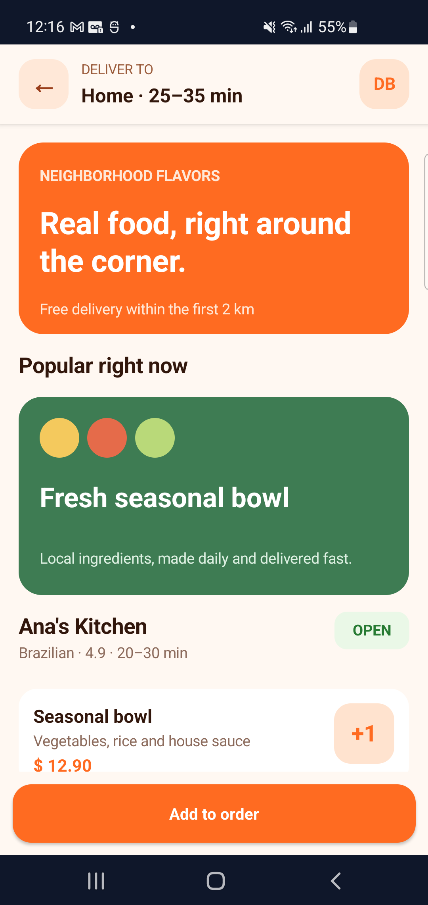
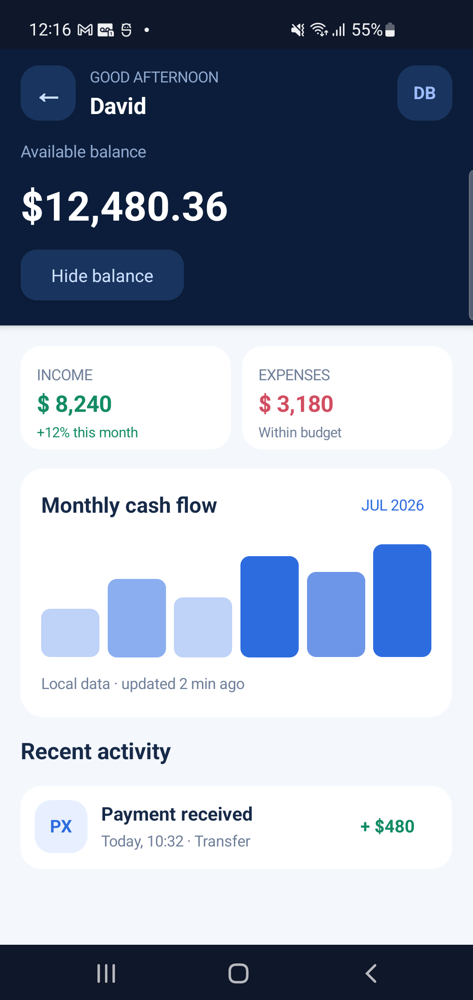
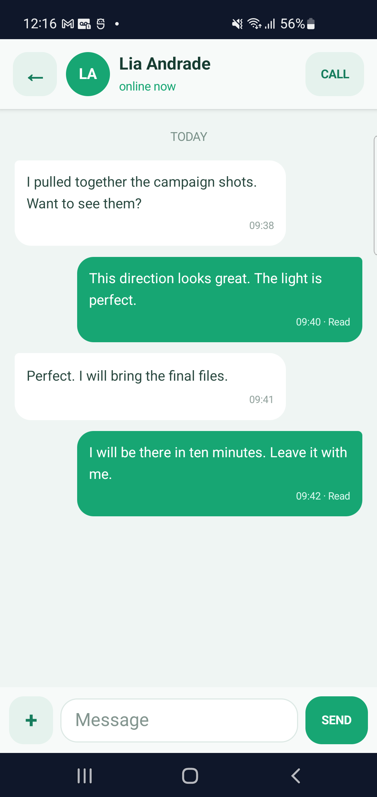
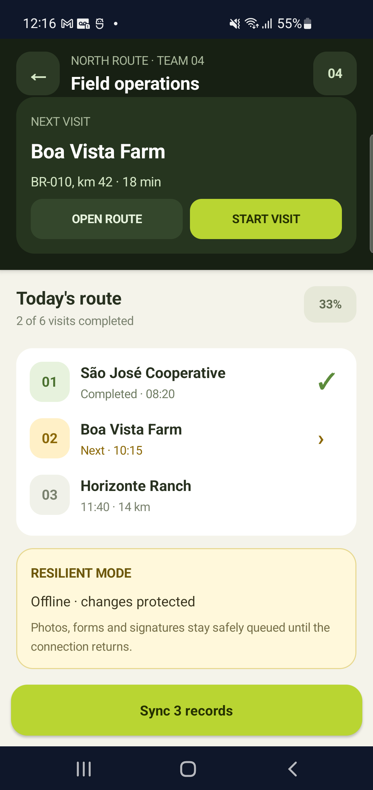

<!-- pam:product-page:start -->
<div align="center">

# PAM Native

**Build real Android and iOS applications with typed PHP.**

A Rust reconciler, retained native renderer, signals, navigation, UI-thread motion, and modular platform capabilities—with no JavaScript runtime or WebView.

[](https://github.com/push-in/pam-native/releases)
[](https://github.com/push-in/pam-native/actions)


**[Documentation](https://push-in.github.io/pam-docs/native/overview/) · [Why this exists](#why-this-exists) · [What you can build](#what-you-can-build) · [Quick start](#quick-start) · [Issues](https://github.com/push-in/pam-native/issues)**

</div>

---

## Why this exists

A Rust reconciler, retained native renderer, signals, navigation, UI-thread motion, and modular platform capabilities—with no JavaScript runtime or WebView.

| | |
| --- | --- |
| **Role** | Native mobile product |
| **Execution path** | PHP 8.5 · Rust · Android Views · UIKit |
| **This repository owns** | Native project workflow, renderer, navigation, state, protocol, and plugin ABI |
| **Boundary** | Camera, video, maps, payments, and other capabilities remain focused packages |

## What you can build

- Production phone and tablet applications
- TV, foldable, keyboard, pointer, and D-pad experiences
- Media, social, commerce, and offline-first products assembled from focused modules

## Quick start

```bash
pam init my-app --template native
cd my-app
pam composer require pushinbr/pam-native
pam doctor --fix
pam dev
```

The **[PAM documentation](https://push-in.github.io/pam-docs/native/overview/)** covers prerequisites, production setup, and the complete workflow. PAM projects keep normal manifests and lockfiles; product features stay in the package that owns them.

Every build follows the mandatory [build hygiene contract](docs/build-hygiene.md):
final APK/AAB/IPA/app deliverables are preserved in `dist`, while regenerable
Gradle, Cargo and Xcode intermediates are removed when the command exits.
Device bundles keep the PHP SDK and its resources; the SDK's native host sources
and documentation stay on the development machine.
<!-- pam:product-page:end -->

PAM Native lets PHP developers ship native mobile applications without adding
a JavaScript runtime or turning the app into a website inside a WebView.

Write familiar PHP components, state, actions, and Laravel-inspired named
routes. PAM keeps your PHP application alive, reconciles its interface in Rust,
and renders real UIKit and Android controls.

## See it in action

```php
<?php

use App\Screens\HomeScreen;
use App\Screens\ProductScreen;
use Pam\Native\App;
use Pam\Native\Routing\Route;

App::run(
    Route::stack('main', initial: 'home', routes: function (): void {
        Route::screen('home', HomeScreen::class);
        Route::screen('product', ProductScreen::class);
    }),
);
```

## It feels familiar because it is

Use explicit PHP trees when you want complete control:

```php
return Screen::make(
    SafeAreaView::make(
        Column::make(
            Text::make('Your cart')->style(new Style(fontSize: 28)),
            Text::make("{$this->items} items"),
            Button::make('Checkout')->onPress($this->checkout(...)),
        )->style(new Style(padding: 24, gap: 16)),
    ),
);
```

Or use single-file components when template authoring is a better fit:

```php
final class Counter extends Component
{
    #[State]
    public int $count = 0;

    #[\Pam\Native\Attributes\Action]
    public function increment(): void
    {
        $this->count++;
    }
}
?>

<template language="2">
    <Column class="card">
        <Text class="title">Count: {{ $count }}</Text>
        <Button label="Increment" @press="increment" />
    </Column>
</template>

<style scoped>
    .card { padding: 24px; gap: 16px; }
    .title { font-size: 28px; font-weight: 700; }
</style>
```

Both styles compile to the same typed retained tree. Scoped styles become
native properties; they are not browser CSS.

Language 2 adds typed tag/event/slot contracts, native interaction states,
compiled tokens and recipes, viewport/container queries, declarative flow and
async branches, stable virtual-list identity, compositor keyframes,
accessibility diagnostics, Composer-extensible tags and a full editor-neutral
LSP. Attributes such as `#[Prop]` and `#[Action]` remain the canonical PHP API.
Read the [UI Language 2 guide](docs/ui-language-2.md).

Lists and scroll views take React Native's pull to refresh directly
(`:refreshing`, `on:refresh`, `tintColor`, `refreshColors`) with the platform
indicator on each side: see [Pull to refresh](docs/pull-to-refresh.md).

Need precise imperative control without introducing a browser runtime? The
[Visual DOM](docs/visual-dom.md) adds indexed selectors, atomic tree mutations,
events, native animation and asynchronous layout observation directly on the
same retained PHP → Rust → Android/UIKit pipeline.

## A complete app (architecture v2)

A small chat app shows the whole architecture: globals, routes, middleware,
composables and screens that use only `setup()`. The full reference is
[Architecture v2](docs/architecture-v2.md).

```
index.php
routes.php
src/
  Api/Api.php
  Composables/useAuth.php
  Middleware/Authenticate.php
  Screens/LoginScreen.pam.php
  Screens/ChatsScreen.pam.php
  Screens/ChatScreen.pam.php
```

**`index.php`** boots the app. The globals are visible in every template and
component.

```php
<?php

use App\Middleware\Authenticate;
use Pam\Native\App;
use function App\Composables\useAuth;
use function Pam\Native\{useColorScheme, useSafeAreaInsets, useNetwork};

require __DIR__.'/vendor/autoload.php';

App::globals([
    'scheme' => useColorScheme(),
    'insets' => useSafeAreaInsets(),
    'online' => useNetwork(),
    'auth'   => useAuth(),
]);
App::middleware(['auth' => Authenticate::class]);
App::run(require __DIR__.'/routes.php');
```

**`routes.php`** declares typed, Laravel-style routes. The `{id}` parameter
arrives in `ChatScreen::setup(string $id)`.

```php
<?php

use App\Screens\{ChatScreen, ChatsScreen, LoginScreen};
use Pam\Native\Route;

Route::screen('/login', LoginScreen::class)->name('login');

Route::middleware('auth')->group(function () {
    Route::screen('/chats', ChatsScreen::class)->name('chats');
    Route::screen('/chat/{id}', ChatScreen::class)->name('chat');
});
```

**`src/Api/Api.php`** is the app's HTTP client, with the JWT and 401
interceptors.

```php
<?php

namespace App\Api;

use Pam\Native\Http\{Http, HttpClient, HttpError, Request};
use function App\Composables\useAuth;

final class Api
{
    private static ?HttpClient $client = null;

    public static function client(): HttpClient
    {
        return self::$client ??= Http::create(baseUrl: 'https://api.example.com')
            ->onRequest(fn (Request $request) => ($token = useAuth()->token->value) !== null
                ? $request->withToken($token) : $request)
            ->onError(function (HttpError $error) {
                if ($error->status === 401) {
                    useAuth()->logout();
                }
                throw $error;
            });
    }
}
```

**`src/Composables/useAuth.php`** is an app composable: shared state, a token
kept in SecureStorage, and navigation on login and logout.

```php
<?php

namespace App\Composables;

use App\Api\Api;
use Pam\Native\Signals\Signal;
use Pam\Native\Storage\SecureStorage;
use function Pam\Native\{navigate, signal};

final class Auth
{
    /** @param Signal<?string> $token @param Signal<?array> $user */
    public function __construct(public readonly Signal $token, public readonly Signal $user)
    {
        SecureStorage::get('token', fn (?string $saved) => $this->token->value = $saved);
    }

    public function login(string $email, string $password): void
    {
        Api::client()->post('/login', ['email' => $email, 'password' => $password])
            ->then(function ($response) {
                $this->token->value = $response->json()['token'];
                $this->user->value = $response->json()['user'];
                SecureStorage::set('token', $this->token->value);
                navigate('chats');
            });
    }

    public function logout(): void
    {
        $this->token->value = null;
        $this->user->value = null;
        SecureStorage::delete('token');
        navigate('login');
    }
}

function useAuth(): Auth
{
    static $auth = null;

    return $auth ??= new Auth(signal(null), signal(null));
}
```

**`src/Middleware/Authenticate.php`** sends signed-out users to the login
screen.

```php
<?php

namespace App\Middleware;

use Closure;
use Pam\Native\{Middleware, Route};
use function App\Composables\useAuth;
use function Pam\Native\redirect;

final class Authenticate implements Middleware
{
    public function handle(Route $to, Closure $next): mixed
    {
        return useAuth()->token->value !== null ? $next($to) : redirect('login');
    }
}
```

**`src/Screens/ChatsScreen.pam.php`** is a paginated, cached list that
refreshes when the screen is focused again. Theme, safe area and connectivity
come from the globals.

```php
<?php

namespace App\Screens;

use App\Api\Api;
use Pam\Native\Component;
use Pam\Native\Composables\Resource;
use function Pam\Native\{navigate, useResource};

final class ChatsScreen extends Component
{
    public Resource $chats;

    public function setup(): void
    {
        $this->chats = useResource(
            fn (?string $cursor) => Api::client()->get('/chats', ['cursor' => $cursor])->json(),
            paginate: true, refreshOnFocus: true, cache: 'chats',
        );
    }

    public function open(int $id): void { navigate('chat', ['id' => $id]); }
    public function refresh(): void { $this->chats->reload(); }
    public function more(): void { $this->chats->more(); }
}
?>

<template>
    <Column class="screen" :class="['dark' => $scheme.dark]" :paddingTop="$insets.top">
        <Text p-if="!$online.value" class="offline">You are offline</Text>
        <VirtualizedList :refreshing="$chats.refreshing" on:refresh="refresh" on:endReached="more">
            <Pressable p-for="$chat in $chats.data" :key="$chat['id']" @press="open($chat['id'])">
                <Text class="title">{{ $chat['title'] }}</Text>
            </Pressable>
        </VirtualizedList>
        <View :height="$insets.bottom" />
    </Column>
</template>
```

**`src/Screens/ChatScreen.pam.php`** receives the route parameter, follows
the keyboard and sends messages optimistically.

```php
<?php

namespace App\Screens;

use App\Api\Api;
use Pam\Native\Component;
use Pam\Native\Composables\{KeyboardState, Resource};
use function Pam\Native\{onBlur, useKeyboard, useResource};

final class ChatScreen extends Component
{
    public string $id;
    public string $draft = '';
    public Resource $messages;
    public KeyboardState $keyboard;

    public function setup(string $id): void
    {
        $this->id = $id;
        $this->keyboard = useKeyboard();
        $this->messages = useResource(
            fn (?string $cursor) => Api::client()->get("/chats/{$id}/messages", ['cursor' => $cursor])->json(),
            paginate: true, cache: "chat:{$id}",
        );
        onBlur(fn () => $this->keyboard->dismiss());
    }

    public function send(): void
    {
        $tmp = ['id' => 'tmp-'.bin2hex(random_bytes(4)), 'text' => $this->draft];
        $this->draft = '';
        $this->messages->prepend($tmp);
        Api::client()->post("/chats/{$this->id}/messages", ['text' => $tmp['text']])
            ->then(fn ($response) => $this->messages->replace($tmp['id'], $response->json()))
            ->catch(fn () => $this->messages->markFailed($tmp['id']));
    }

    public function more(): void { $this->messages->more(); }
}
?>

<template>
    <Column class="screen" :paddingTop="$insets.top" :paddingBottom="$keyboard.visible ? $keyboard.height : $insets.bottom">
        <VirtualizedList inverted on:endReached="more">
            <Text p-for="$message in $messages.data" :key="$message['id']" :class="['failed' => $message['_failed'] ?? false]">
                {{ $message['text'] }}
            </Text>
        </VirtualizedList>
        <Row>
            <Input p-model="$draft" />
            <Button label="Send" @press="send" />
        </Row>
    </Column>
</template>
```

Code written before v2 keeps working: `mount()`, constructor route parameters,
`Appearance::onChange()` and the other earlier APIs are still supported. They
are marked `@deprecated` and each one points to its replacement.

## Native where it matters

- Real Android Views and UIKit controls
- Native stack, tabs, drawers, sheets, headers, gestures, and transitions
- Recycled lists and grids for large datasets
- Keyboard-safe inputs, safe areas, accessibility, and reduced motion
- Camera, media library, audio, contacts, location, sensors, notifications,
  push, sharing, files, SQLite, and secure storage
- Background execution and offline-first state
- Native animation and gesture execution without per-frame PHP traffic
- Hot reload, profiling, time travel, diagnostics, and repeatable benchmarks
- A plugin SDK for application-specific native modules and views

PHP describes the experience. Rust performs reconciliation and layout. Kotlin
and Swift apply bounded native mutations once per display frame.

## Built for real products

PAM Native includes the parts that demos usually skip:

- process and navigation restoration;
- bounded payloads, queues, caches, and retained state;
- typed integer-backed protocol enums;
- exact-host WebView allowlists and canonical file access;
- offline media caching and retry-safe operations;
- API 26 and API 36 Android contracts;
- UIKit simulator tests;
- deterministic protocol fuzzing;
- performance budgets and baseline profiles.

The public showcase includes a marketplace, finance dashboard, chat composer,
offline field workflow, component lab, hot reload, and a recycled list with
10,000 rows.

<table>
  <tr>
    <td align="center"></td>
    <td align="center"></td>
    <td align="center"></td>
    <td align="center"></td>
  </tr>
</table>

Explore the [showcase source](examples/showcase) or follow the
[showcase guide](docs/showcase.md) to build it locally.

## The PAM ecosystem

- **[24 official ecosystem packages](docs/ecosystem-architecture.md)** — Firebase,
  auth, payments, subscriptions, maps, media, background transfer, realtime,
  offline sync, extensions, device capabilities, observability, testing, and
  plugin tooling. Install only the capabilities your application uses.
- **[PAM Native Nitro](https://github.com/push-in/pam-native-nitro)** — typed,
  offline-first models and native SQLite queries.
- **[PAM](https://github.com/push-in/pam)** — the persistent PHP runtime,
  async I/O, CLI, and wider application platform.
- **[Plugin SDK](docs/plugins.md)** — connect native SDKs, modules, views,
  resources, and PHP service providers.

## Learn at your pace

Start with the short path, then open the internals only when you need them:

1. [Create your first app](https://push-in.github.io/pam-docs/native/overview/)
2. [Build components](docs/components.md) and the [v2 app architecture](docs/architecture-v2.md)
3. [Declare named routes](docs/navigation.md)
4. [Manage local and global state](docs/store.md)
5. [Use native capabilities](docs/examples.md)
6. [Understand performance and recovery](docs/runtime-performance.md)

For protocol, renderer, and runtime details, use the
[technical documentation index](docs/README.md).

## Advanced: install only the SDK

Generated PAM projects already configure this dependency. Direct Composer
installation is intended for custom hosts and framework contributors; most
applications should start with `pam init` or `pam add`:

```bash
pam composer require pushinbr/pam-native:^1.0
```

## Community

Bug reports, focused feature proposals, documentation fixes, components, and
plugins are welcome. Start with the
[contribution guide](https://push-in.github.io/pam-docs/community/contributing/)
or open a discussion describing the application you want to build.

PAM Native is open source under Apache-2.0. You may build and sell
proprietary or open applications with it without a revenue limit or runtime
royalty. See [LICENSING.md](LICENSING.md) for the plain-language grant and the
full [LICENSE](LICENSE) for controlling terms.

### Drawer e Toast opcionais (1.46)

Instale `pushinbr/pam-native-drawer:0.1.0` para Drawer e
`pushinbr/pam-native-toast:0.1.0` para Toast. Migre os imports para
`Pam\Native\Drawer` e `Pam\Native\Toast`. Os nomes antigos usam `MovedToPlugin`:
com o pacote instalado são aliases; sem ele, informam o comando Composer.
O núcleo conserva os IDs reservados e os ganchos genéricos de módulos/views;
não inclui o renderizador de Drawer nem a aparência ou variantes de Toast.
O real-world app depende somente do plugin Toast.
