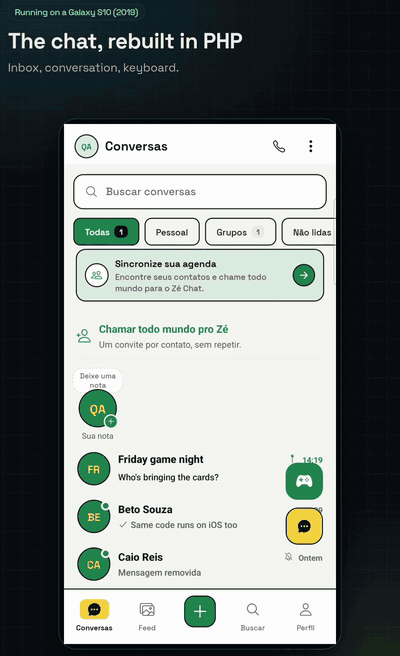
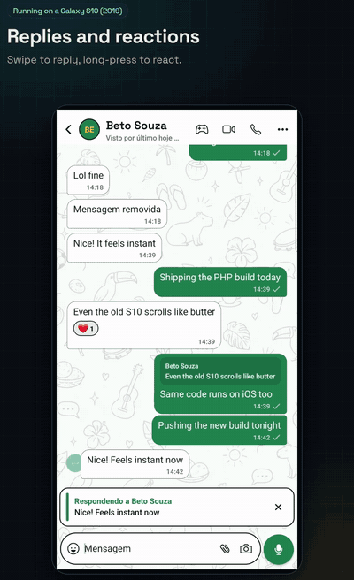
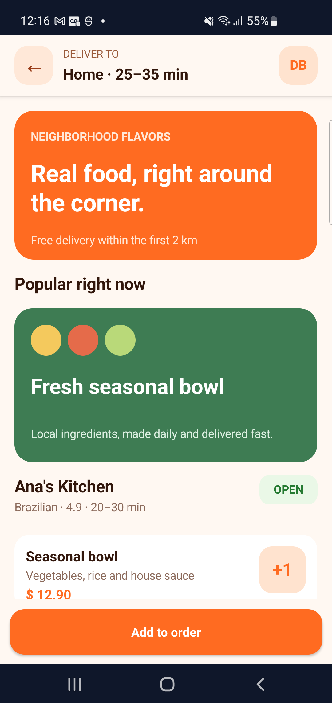
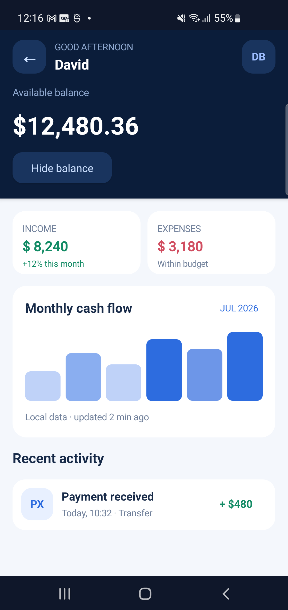
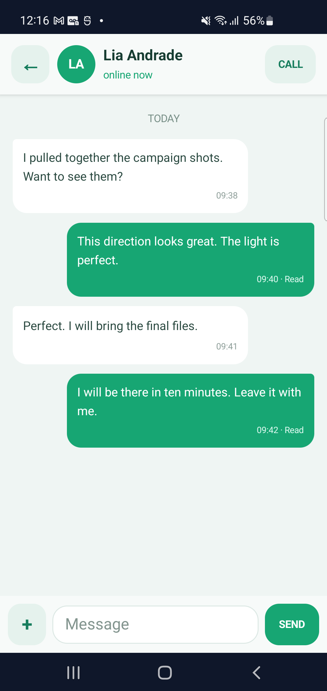
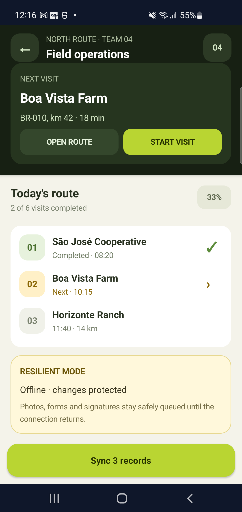

<div align="center">

<picture>
  <source media="(prefers-color-scheme: dark)" srcset=".github/assets/banner-dark.svg">
  
</picture>

**Build real Android and iOS applications with typed PHP.**<br>
A Rust reconciler, retained native renderer, signals, navigation, UI-thread motion and modular platform capabilities.<br>No JavaScript runtime or WebView.

[](https://packagist.org/packages/pushinbr/pam-native)
[](https://github.com/push-in/pam-native/releases/latest)

[](https://github.com/push-in/pam-native/actions/workflows/ci.yml)
[](LICENSE)

[Install](#install) · [Quick example](#quick-example) · [Zé Chat](#built-with-pam-native-ze-chat) · [Platforms](#platform-support) · [Docs](#docs) · [Issues](https://github.com/push-in/pam-native/issues)

</div>

<a id="built-with-pam-native-ze-chat"></a>
## <picture></picture> Built with PAM Native: Zé Chat

Zé Chat is a production chat app that was rewritten from React Native to PHP with PAM Native. These clips were recorded on a 2019 Galaxy S10.

<table>
  <tr>
    <td align="center"><a href="docs/assets/zechat/zechat-chat.mp4"></a><br><sub>Inbox, conversation, keyboard</sub></td>
    <td align="center"><a href="docs/assets/zechat/zechat-replies.mp4"></a><br><sub>Swipe to reply, long-press to react</sub></td>
    <td align="center"><a href="docs/assets/zechat/zechat-scroll-theme.mp4"></a><br><sub>150+ messages, light and dark</sub></td>
  </tr>
</table>

<sub>Click a clip for the MP4. The public [showcase](examples/showcase) (marketplace, finance dashboard, chat composer, offline field workflow) is in this repository; see the [showcase guide](docs/showcase.md).</sub>

<a id="install"></a>
## <picture></picture> Install

Create a PAM Native project and run it:

```sh
pam init my-app --template native
cd my-app
pam doctor --fix
pam dev
```

`pam init --template native` already adds `pushinbr/pam-native` (`^1.0`) to the project's `composer.json`; add capabilities with `pam composer require pushinbr/pam-native-<capability>`. The [PAM Native overview](https://push-in.github.io/pam-docs/native/overview/) covers prerequisites, production setup and the complete workflow. PAM projects keep normal manifests and lockfiles; product features stay in the package that owns them.

Every build follows the mandatory [build hygiene contract](docs/build-hygiene.md): final APK/AAB/IPA/app deliverables are preserved in `dist`, while regenerable Gradle, Cargo and Xcode intermediates are removed when the command exits. Device bundles keep the PHP SDK and its resources; the SDK's native host sources and documentation stay on the development machine.

<details>
<summary><b>Advanced: install only the SDK</b></summary>

Generated PAM projects already configure this dependency. Direct Composer installation is intended for custom hosts and framework contributors:

```sh
pam composer require pushinbr/pam-native:^1.0
```

</details>

<a id="quick-example"></a>
## <picture></picture> Quick example

Write familiar PHP components, state, actions and Laravel-inspired named routes. PAM keeps your PHP application alive, reconciles its interface in Rust, and renders real UIKit and Android controls.

```php
<?php

use App\Screens\HomeScreen;
use App\Screens\ProductScreen;
use Pam\Native\App;
use Pam\Native\Routing\Route;

App::run(
    Route::stack('main', initial: 'home', routes: function (): void {
        Route::screen('home', HomeScreen::class);
        Route::screen('product', ProductScreen::class);
    }),
);
```

<a id="platform-support"></a>
## <picture></picture> Platform support

| Platform | Support | Notes |
| --- | --- | --- |
| Android | API 26+ (default `minSdk`), compiled against API 36 | Real Android Views; API 26 and API 36 contracts |
| iOS | 15.0+ (default `ios.minimumVersion`) | UIKit controls; UIKit simulator tests |

<a id="it-feels-familiar"></a>
## <picture></picture> It feels familiar because it is

Use explicit PHP trees when you want complete control:

```php
return Screen::make(
    SafeAreaView::make(
        Column::make(
            Text::make('Your cart')->style(new Style(fontSize: 28)),
            Text::make("{$this->items} items"),
            Button::make('Checkout')->onPress($this->checkout(...)),
        )->style(new Style(padding: 24, gap: 16)),
    ),
);
```

Or use single-file components when template authoring is a better fit:

```php
final class Counter extends Component
{
    #[State]
    public int $count = 0;

    #[\Pam\Native\Attributes\Action]
    public function increment(): void
    {
        $this->count++;
    }
}
?>

<template language="2">
    <Column class="card">
        <Text class="title">Count: {{ $count }}</Text>
        <Button label="Increment" @press="increment" />
    </Column>
</template>

<style scoped>
    .card { padding: 24px; gap: 16px; }
    .title { font-size: 28px; font-weight: 700; }
</style>
```

Both styles compile to the same typed retained tree. Scoped styles become
native properties; they are not browser CSS.

Language 2 adds typed tag/event/slot contracts, native interaction states,
compiled tokens and recipes, viewport/container queries, declarative flow and
async branches, stable virtual-list identity, compositor keyframes,
accessibility diagnostics, Composer-extensible tags and a full editor-neutral
LSP. Attributes such as `#[Prop]` and `#[Action]` remain the canonical PHP API.
Read the [UI Language 2 guide](docs/ui-language-2.md).

Lists and scroll views take React Native's pull to refresh directly
(`:refreshing`, `on:refresh`, `tintColor`, `refreshColors`) with the platform
indicator on each side: see [Pull to refresh](docs/pull-to-refresh.md).

Need precise imperative control without introducing a browser runtime? The
[Visual DOM](docs/visual-dom.md) adds indexed selectors, atomic tree mutations,
events, native animation and asynchronous layout observation directly on the
same retained PHP → Rust → Android/UIKit pipeline.

A small chat app that shows the whole v2 architecture (globals, routes, middleware, composables and screens that use only `setup()`) is in [docs/complete-app.md](docs/complete-app.md); the full reference is [Architecture v2](docs/architecture-v2.md).

<a id="native-where-it-matters"></a>
## <picture></picture> Native where it matters

- Real Android Views and UIKit controls
- Native stack, tabs, drawers, sheets, headers, gestures, and transitions
- Recycled lists and grids for large datasets
- Keyboard-safe inputs, safe areas, accessibility, and reduced motion
- Camera, media library, audio, contacts, location, sensors, notifications,
  push, sharing, files, SQLite, and secure storage
- Background execution and offline-first state
- Native animation and gesture execution without per-frame PHP traffic
- Hot reload, profiling, time travel, diagnostics, and repeatable benchmarks
- A plugin SDK for application-specific native modules and views

PHP describes the experience. Rust performs reconciliation and layout. Kotlin
and Swift apply bounded native mutations once per display frame.

<a id="built-for-real-products"></a>
## <picture></picture> Built for real products

PAM Native includes the parts that demos usually skip:

- process and navigation restoration;
- bounded payloads, queues, caches, and retained state;
- typed integer-backed protocol enums;
- exact-host WebView allowlists and canonical file access;
- offline media caching and retry-safe operations;
- API 26 and API 36 Android contracts;
- UIKit simulator tests;
- deterministic protocol fuzzing;
- performance budgets and baseline profiles.

The public showcase includes a marketplace, finance dashboard, chat composer,
offline field workflow, component lab, hot reload, and a recycled list with
10,000 rows.

<table>
  <tr>
    <td align="center"></td>
    <td align="center"></td>
    <td align="center"></td>
    <td align="center"></td>
  </tr>
</table>

Explore the [showcase source](examples/showcase) or follow the
[showcase guide](docs/showcase.md) to build it locally.

<a id="drawer-and-toast"></a>
## <picture></picture> Optional Drawer and Toast (1.46)

Install `pushinbr/pam-native-drawer` for Drawer and `pushinbr/pam-native-toast` for Toast, and move the imports to `Pam\Native\Drawer` and `Pam\Native\Toast`. The old names use `MovedToPlugin`: with the package installed they are aliases; without it they print the Composer command. The core keeps the reserved IDs and the generic module/view hooks; it does not include the Drawer renderer or the Toast appearance and variants. The real-world app depends only on the Toast plugin.

<a id="community"></a>
## <picture></picture> Community

Bug reports, focused feature proposals, documentation fixes, components and plugins are welcome. Start with the [contribution guide](https://push-in.github.io/pam-docs/community/contributing/) or open a discussion describing the application you want to build.

PAM Native is open source under Apache-2.0. You may build and sell proprietary or open applications with it without a revenue limit or runtime royalty. See [LICENSING.md](LICENSING.md) for the plain-language grant and the full [LICENSE](LICENSE) for controlling terms.

<a id="docs"></a>
## <picture></picture> Docs

- [Create your first app](https://push-in.github.io/pam-docs/native/overview/)
- [Build components](docs/components.md)
- [v2 app architecture](docs/architecture-v2.md)
- [Declare named routes](docs/navigation.md)
- [Manage local and global state](docs/store.md)
- [Use native capabilities](docs/examples.md)
- [Performance and recovery](docs/runtime-performance.md)
- [UI Language 2](docs/ui-language-2.md)
- [Plugin SDK](docs/plugins.md)
- [Ecosystem architecture](docs/ecosystem-architecture.md)
- [PAM Native Nitro](https://github.com/push-in/pam-native-nitro): typed, offline-first models and native SQLite queries
- [Technical documentation index](docs/README.md)
- [Changelog](CHANGELOG.md)

<a id="pam-ecosystem"></a>
## <picture></picture> Part of the PAM ecosystem

<p align="center"><picture>
  <source media="(prefers-color-scheme: dark)" srcset=".github/assets/pam-wordmark-dark.svg">
  
</picture></p>

PAM runs PHP natively on servers, desktops and phones. This repository is one piece of it.

| [**PAM**](https://github.com/push-in/pam) | [**PAM Desktop**](https://github.com/push-in/pam-desktop) | [**Ecosystem**](https://github.com/push-in/pam#ecosystem) |
| --- | --- | --- |
| the runtime and CLI | native desktop apps in PHP | every official package and plugin |

<sub>Docs: [push-in.github.io/pam-docs](https://push-in.github.io/pam-docs/introduction/) · [Issues](https://github.com/push-in/pam-native/issues)</sub>

<p align="center"><sub><a href="LICENSE">Apache License 2.0</a> · <a href="LICENSING.md">licensing guide</a> · Made in Brazil by Pushin</sub></p>
